<!--
    DO NOT EDIT THIS FILE BY HAND.

    This file is automatically generated by /home/shingo/ros/kinetic/src/jsk-ros-pkg/jsk_visualization/generate_readme.py at 2020-04-04T19:02:37.843225.
-->

jsk\_visualization
=================

 

jsk visualization ros package.

See [read the docs](http://jsk-visualization.readthedocs.org/en/latest/).

Gallery
-------

### [jsk_rviz_plugins](http://jsk_visualization.readthedocs.io/en/latest/jsk_rviz_plugins)

[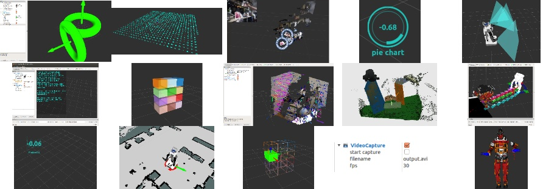](http://jsk_visualization.readthedocs.io/en/latest/jsk_rviz_plugins)

### [jsk_rqt_plugins](http://jsk_visualization.readthedocs.io/en/latest/jsk_rqt_plugins)

[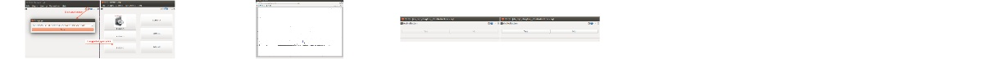](http://jsk_visualization.readthedocs.io/en/latest/jsk_rqt_plugins)

ROS 1 / ROS 2 gallery
---------------------

The same source tree builds for ROS 1 (rviz, rqt) and ROS 2 (rviz2, rqt).
These are the sample launch files (`roslaunch <pkg> <sample>.launch` on ROS 1,
`ros2 launch <pkg> <sample>.launch.py` on ROS 2) and the rqt scripts (`rosrun` / `ros2 run`)
captured on ROS One (rviz) and on ROS 2 Jazzy (rviz2); in the GIFs of the interactive markers
and of image_view2 the markers and the image are dragged with the mouse.
On ROS 2, the plugins of jsk_recognition_msgs (BoundingBoxArray, PolygonArray, SegmentArray,
HistogramPlot, Plot2D) and their samples are built when jsk_recognition_msgs is found, which is
not released for ROS 2 yet and has to be built from source in the workspace.

### jsk_rviz_plugins

| plugin / sample | ROS 1 | ROS 2 |
|:--|:--:|:--:|
| OverlayText, String, Plotter2D, PieChart, OverlayImage, OverlayMenu, OverlayDiagnostic `overlay_sample` | 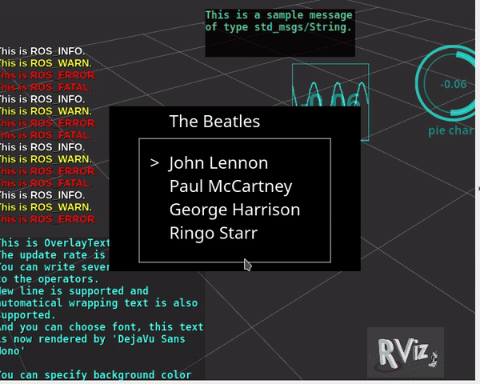 |  |
| Pictogram, PictogramArray `pictogram_sample` | 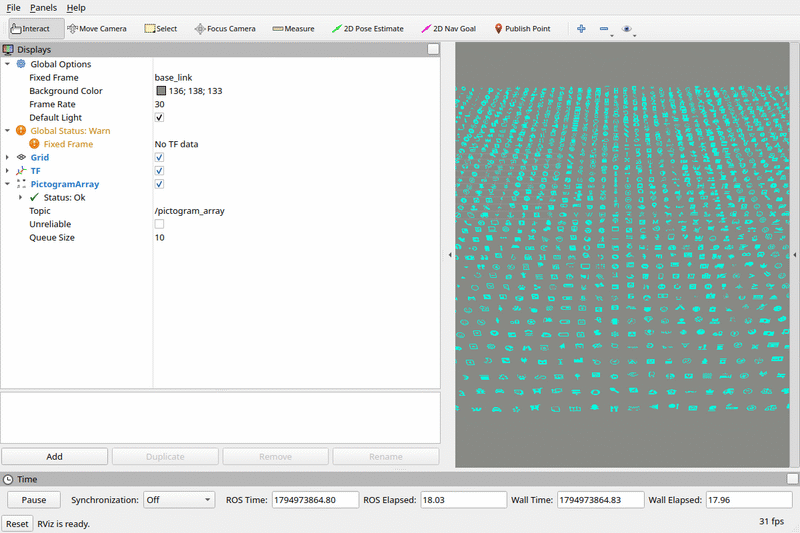 | 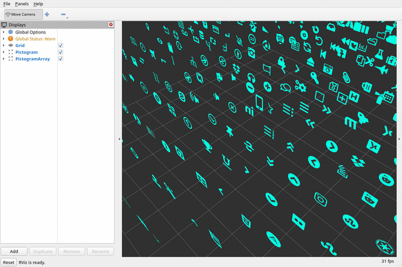 |
| LinearGauge `linear_gauge_sample` | 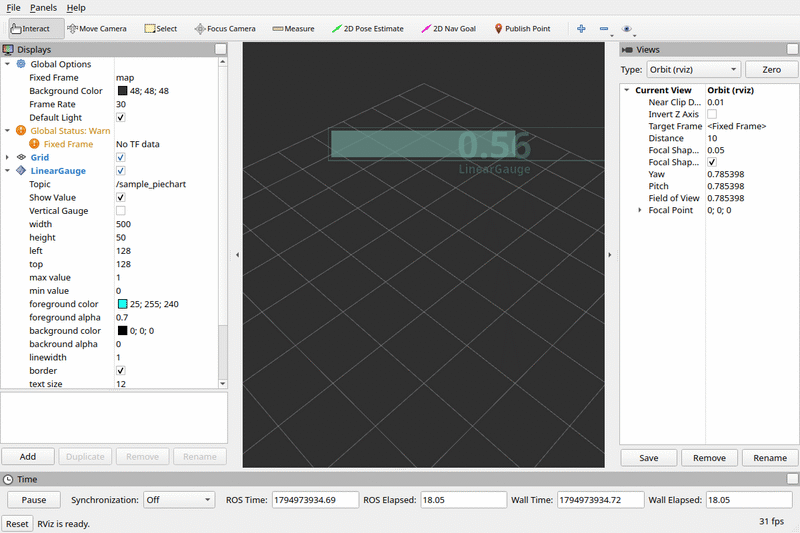 | 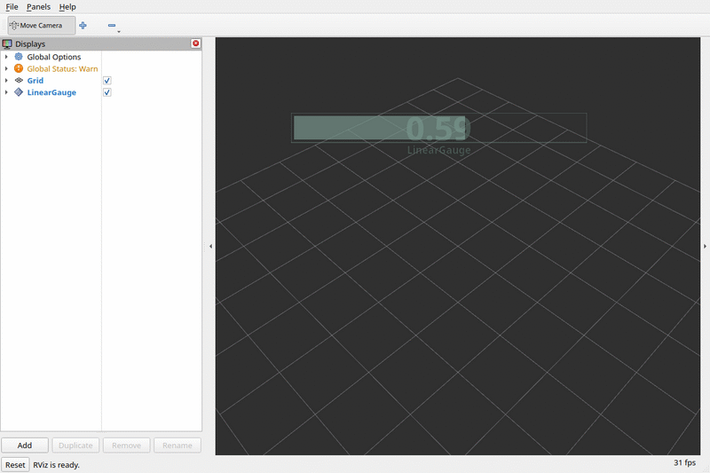 |
| PieChart `piechart_sample` | 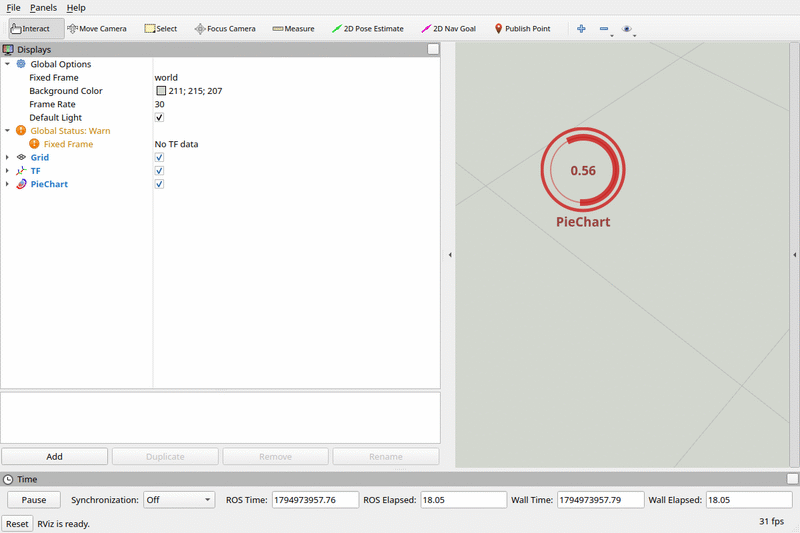 |  |
| RobotCommandInterfaceAction (panel) `robot_command_interface_sample` | 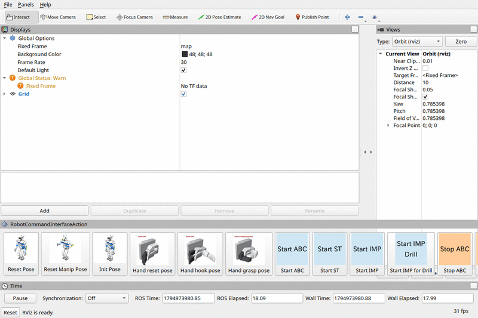 | 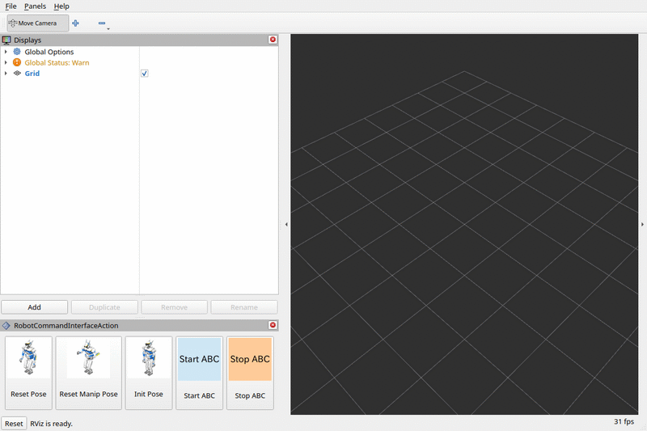 |
| EmptyServiceCallInterfaceAction (panel) `service_call_panel` | 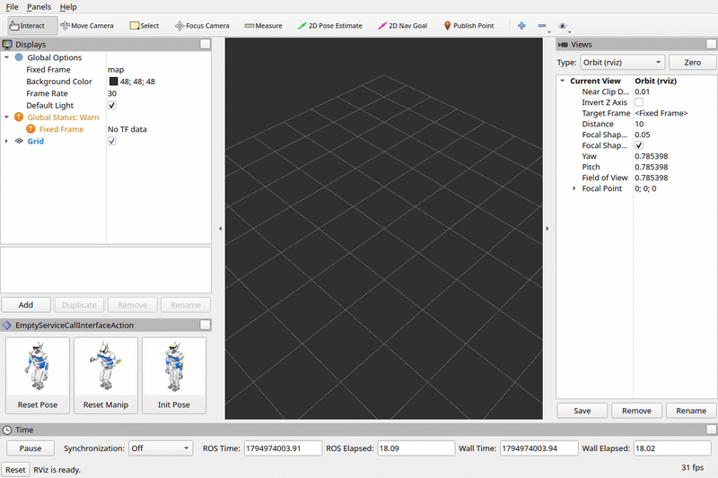 |  |
| BoundingBoxArray `boundingbox_sample` | 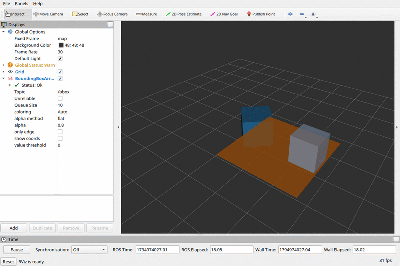 | 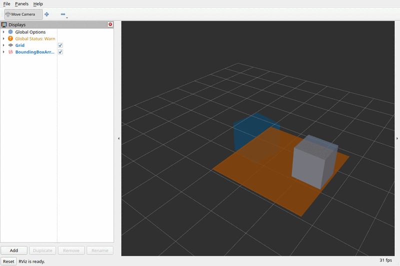 |
| PolygonArray `polygon_array_sample` | 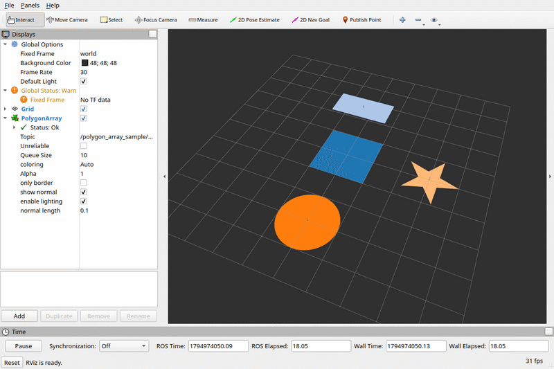 |  |
| SegmentArray `segment_array_sample` | 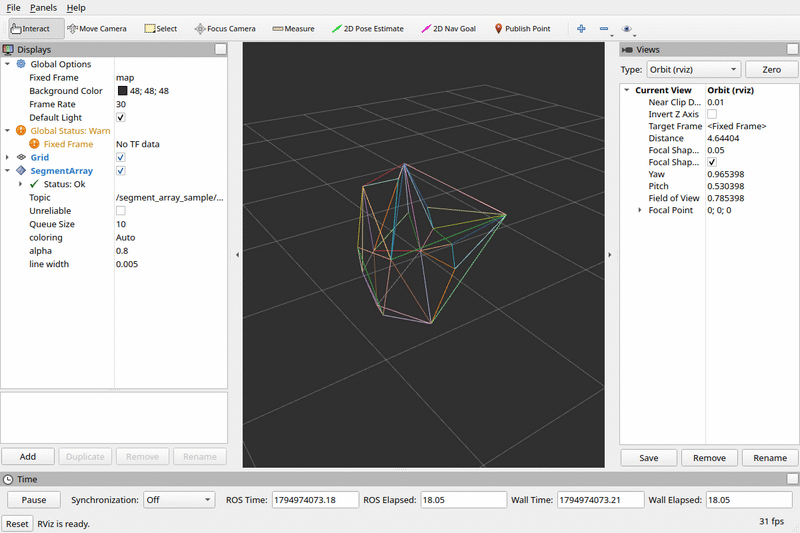 |  |

### jsk_rqt_plugins

| plugin / sample | ROS 1 | ROS 2 |
|:--|:--:|:--:|
| StringLabel `rqt_string_label` | 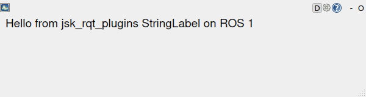 | 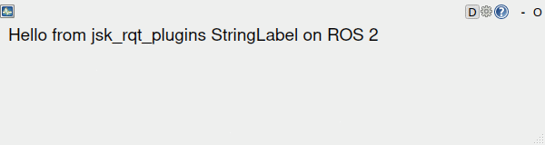 |
| StatusLight `rqt_status_light` | 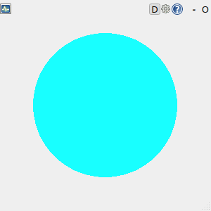 |  |
| YesNoButton `rqt_yn_btn` |  |  |
| ImageView2Plugin (with image_view2) `sample_image_view2` |  |  |
| Plot3D `sample_3dplot` | 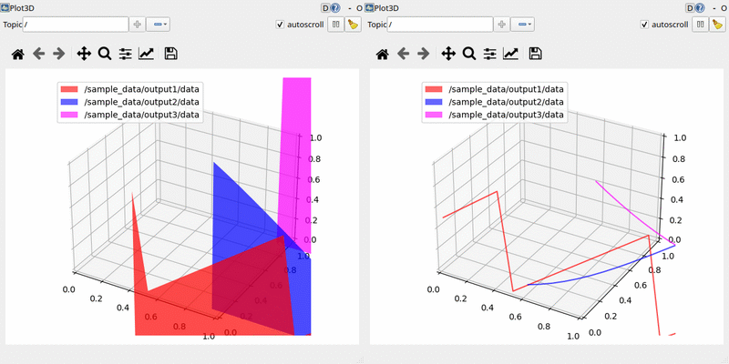 | 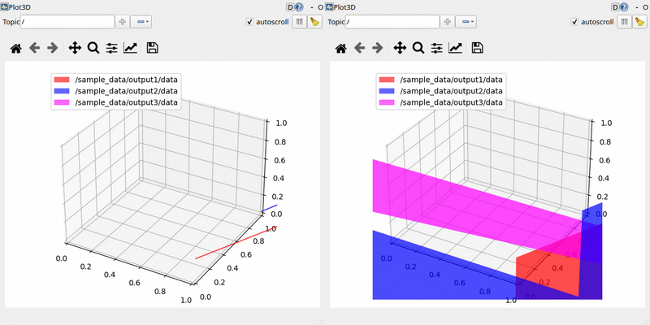 |
| ServiceButtons `sample_service_buttons` | 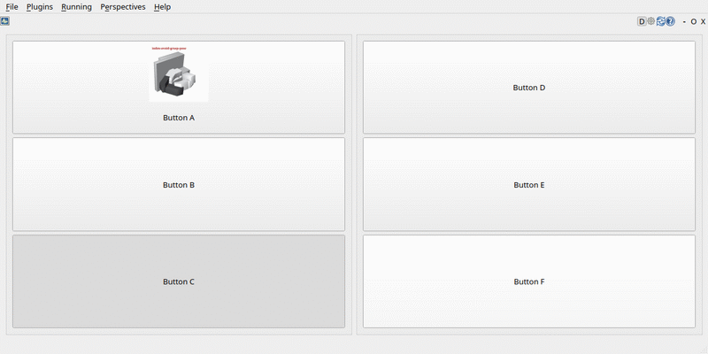 | 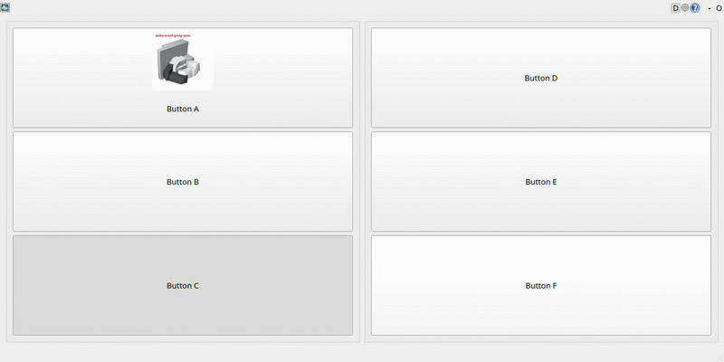 |
| ServiceRadioButtons `sample_service_radio_buttons` | 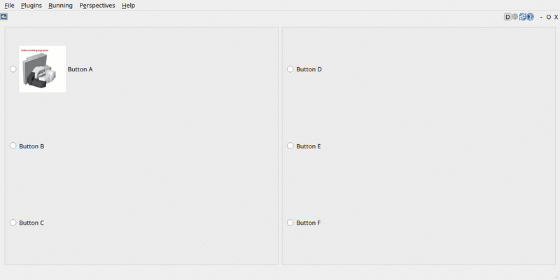 |  |
| ServiceTabbedButtons `sample_tabbed_buttons` | 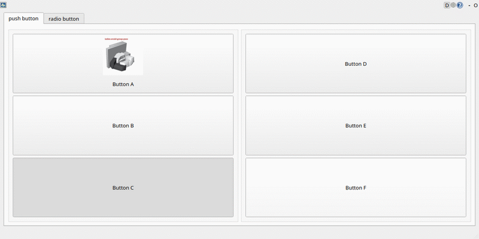 |  |
| DRCEnvironmentViewer `sample_drc_mini_maxwell` | 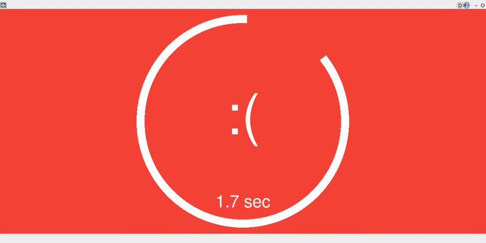 | 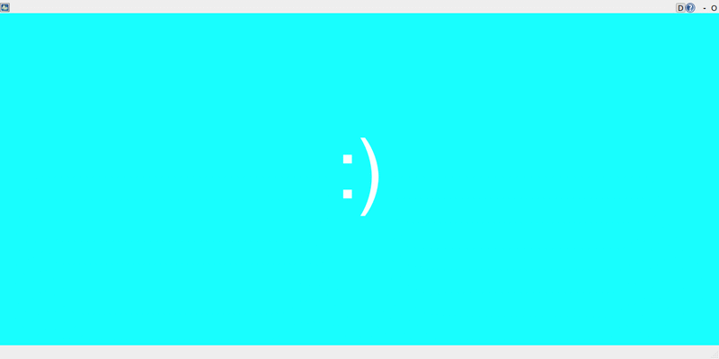 |
| HistogramPlot `sample_histogram` | 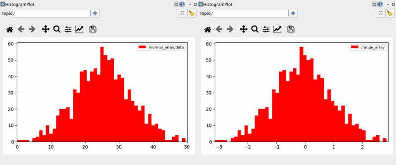 | 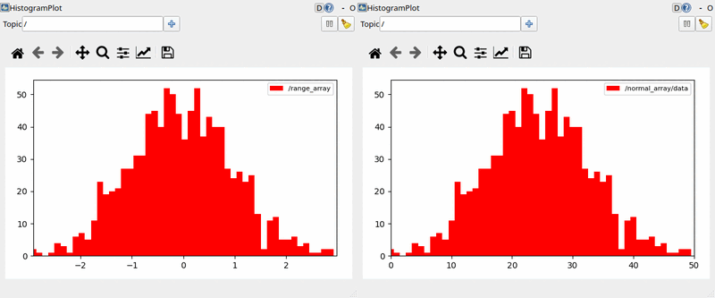 |
| Plot2D `sample_2dplot` | 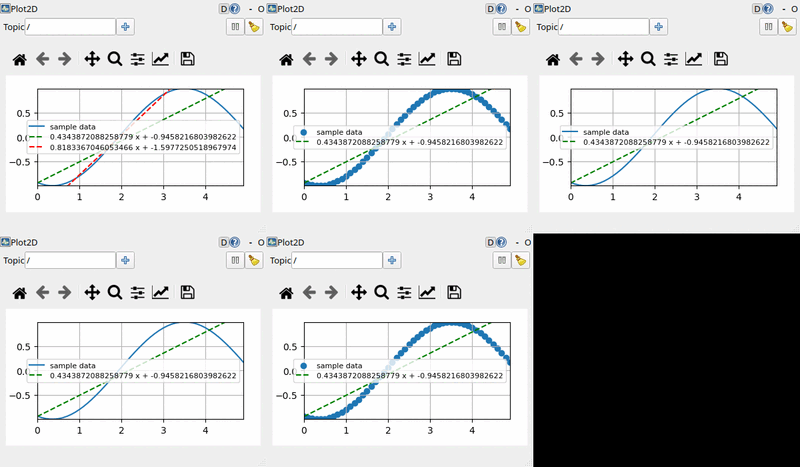 |  |

### jsk_interactive_marker

| plugin / sample | ROS 1 | ROS 2 |
|:--|:--:|:--:|
| marker_6dof `marker_6dof_sample` | 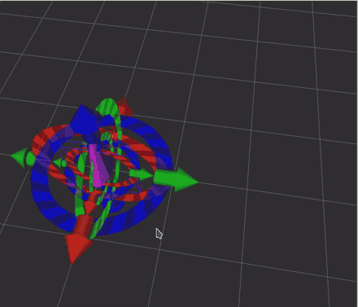 |  |
| transformable_server_sample `transformable_server_sample` | 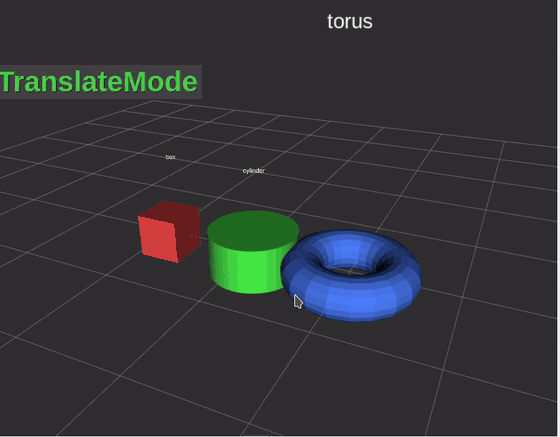 | 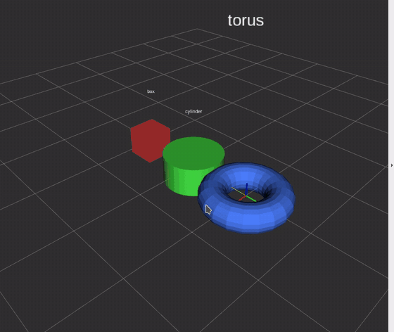 |

Deb build status
----------------

[//]: # (!!DO NOT EDIT !!)

[//]: # (THIS SECTION IS AUTOMATICALLY GENERATED BY)

[//]: # (rosrun jsk_tools generate_deb_status_table.py jsk_visualization)

| Package                   | Kinetic (Xenial)                                                                                                                                                                                               | Melodic (Bionic)                                                                                                                                                                                               | Melodic (Stretch)                                                                                                                                                                                                | Noetic (Focal)                                                                                                                                                                                               | Noetic (Buster)                                                                                                                                                                                                |
|:--------------------------|:---------------------------------------------------------------------------------------------------------------------------------------------------------------------------------------------------------------|:---------------------------------------------------------------------------------------------------------------------------------------------------------------------------------------------------------------|:-----------------------------------------------------------------------------------------------------------------------------------------------------------------------------------------------------------------|:-------------------------------------------------------------------------------------------------------------------------------------------------------------------------------------------------------------|:---------------------------------------------------------------------------------------------------------------------------------------------------------------------------------------------------------------|
| jsk_visualization (arm64) |  |  |  |  |  |
| jsk_visualization (armhf) |  |  | ---                                                                                                                                                                                                              |  | ---                                                                                                                                                                                                            |
| jsk_visualization (i386)  |              | ---                                                                                                                                                                                                            | ---                                                                                                                                                                                                              | ---                                                                                                                                                                                                          | ---                                                                                                                                                                                                            |
| jsk_visualization (amd64) |            |            |      |            |      |

[//]: #
