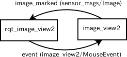

rqt\_image\_view2
=================


rqt wrapper of image_view2.

It retrieves `image_marked` topic from `image_view2` and publish `event` topic to `image_view2`.




Sample
------

```
$ roslaunch jsk_rqt_plugins sample_image_view2.launch
```

On ROS 2, with the sample of image_view2:

```
$ ros2 launch image_view2 sample_image_view2.launch.xml gui:=false
$ ros2 run jsk_rqt_plugins rqt_image_view2
```

Then select the image topic (`/camera/image` on ROS 2) with the configuration (gear) button.
