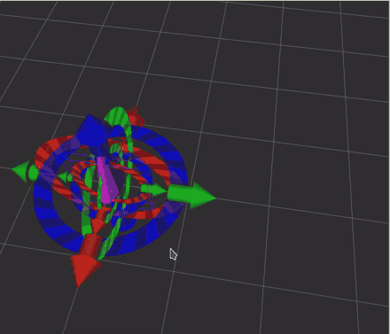
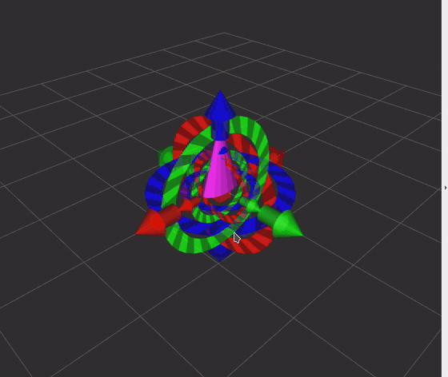
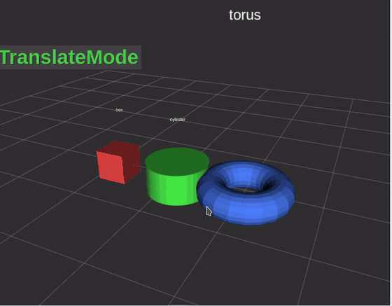
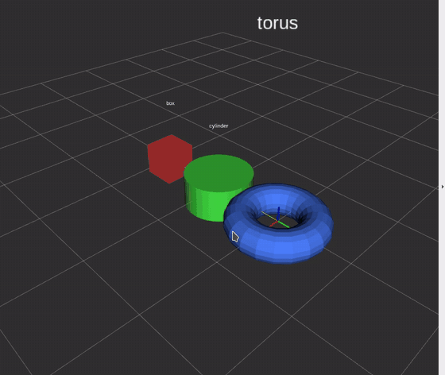
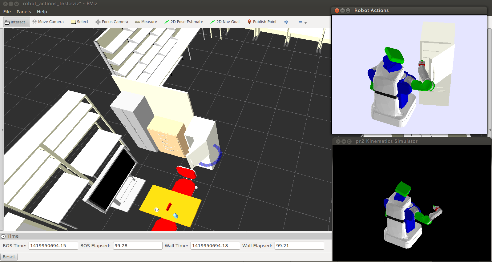

jsk_interactive_marker
======================

Interactive marker servers (6-DoF markers, transformable boxes, cylinders,
tori and meshes, URDF models, ...) and rviz panels to operate them.
The same source tree builds for ROS 1 and ROS 2. The samples below have a
`<sample>.launch` for ROS 1 and a `<sample>.launch.py` for ROS 2; the
other launch files and the EusLisp tools in [Usage](#usage) are ROS 1 only.

The nodes are documented in [`doc/jsk_interactive_marker`](../../doc/jsk_interactive_marker)
(also on [read the docs](https://jsk-visualization.readthedocs.io/en/latest/jsk_interactive_marker/index.html)).

# Samples

- [marker_6dof_sample](#marker_6dof_sample): marker_6dof
- [transformable_server_sample](#transformable_server_sample): transformable_server_sample

Drag the markers in rviz / rviz2 with the mouse (the Interact tool).
The ROS 2 launch files take `gui:=false` to start without rviz2.

## marker_6dof_sample

Nodes: marker_6dof (a cube, a sphere, a line and a mesh, each with a 6-DoF interactive marker)

Docs: [marker_6dof](../../doc/jsk_interactive_marker/nodes/marker_6dof.md)

| ROS 1 | ROS 2 |
|:--:|:--:|
|  |  |

How to run:

```bash
# ROS 1
roslaunch jsk_interactive_marker marker_6dof_sample.launch
# ROS 2
ros2 launch jsk_interactive_marker marker_6dof_sample.launch.py
```

## transformable_server_sample

Nodes: transformable_server_sample (transformable boxes, cylinders, tori and meshes)

Docs: [transformable_server_sample](../../doc/jsk_interactive_marker/nodes/transformable_server_sample.md)

| ROS 1 | ROS 2 |
|:--:|:--:|
|  |  |

How to run:

```bash
# ROS 1
roslaunch jsk_interactive_marker transformable_server_sample.launch
# ROS 2
ros2 launch jsk_interactive_marker transformable_server_sample.launch.py
```

The sample starts with no object. Insert one with the `request_marker_operate`
service (`type`: 0 box, 1 cylinder, 2 torus):

```bash
# ROS 1
rosservice call /server_sample/request_marker_operate "operate: {type: 0, action: 0, frame_id: 'map', name: 'box', description: 'box'}"
# ROS 2
ros2 service call /server_sample/request_marker_operate jsk_rviz_plugins/srv/RequestMarkerOperate "{operate: {type: 0, action: 0, frame_id: 'map', name: 'box', description: 'box'}}"
```

On ROS 1 the launch file also starts the nodes for a KORG nanoKONTROL
(`korg_nanokontrol`) and a SpaceNavigator (`spacenav_node`). The sample works
without the devices; if `korg_nanokontrol` is not installed, roslaunch reports
that it cannot launch that node and starts the others. The ROS 2 launch file
has no such nodes.

# Usage
## urdf_model_markers.launch
This launch file generates interactive markers from urdf models.
```
$ roslaunch jsk_interactive_marker urdf_model_markers.launch models:=/path/to/model.yaml
```

### example
```
$ roslaunch jsk_interactive_marker urdf_model_markers.launch models:=`rospack find jsk_interactive_marker`/launch/models/urdf_model_markers.yaml
```

## room2yaml.l
This script generates yaml files for urdf_model_marker.
```
$ roscd jsk_interactive_marker/euslisp
$ rosrun roseus roseus room2yaml.l
```

## robot_actions_sample.launch
This is a sample launch file to test urdf_model_marker and robot-actions.l.
Before launching this, You need to execute room2yaml.l once.
```
$ roslaunch jsk_interactive_marker robot_actions_sample.launch
```

