jsk_rqt_plugins
===============

rqt plugins: labels, status lights, yes/no and service buttons, plots and an
rqt wrapper of image_view2.
The same source tree builds for ROS 1 and ROS 2. Each plugin also has a
standalone script in `bin/` (`rosrun jsk_rqt_plugins <script>` on ROS 1,
`ros2 run jsk_rqt_plugins <script>` on ROS 2), and the samples have a
`sample/<sample>.launch` for ROS 1 and a `sample/<sample>.launch.py` for ROS 2.

On ROS 2, HistogramPlot and Plot2D (`rqt_histogram_plot`, `rqt_2d_plot`) and
their samples are installed only when jsk_recognition_msgs is found.
jsk_recognition_msgs is not released for ROS 2 yet, so build it from source in
your workspace.

Each plugin is documented in [`doc/jsk_rqt_plugins`](../doc/jsk_rqt_plugins)
(also on [read the docs](https://jsk-visualization.readthedocs.io/en/latest/jsk_rqt_plugins/index.html)).

Samples
-------

- [rqt_string_label](#rqt_string_label): StringLabel
- [rqt_status_light](#rqt_status_light): StatusLight
- [rqt_yn_btn](#rqt_yn_btn): YesNoButton
- [sample_image_view2](#sample_image_view2): ImageView2Plugin (with image_view2)
- [sample_3dplot](#sample_3dplot): Plot3D
- [sample_service_buttons](#sample_service_buttons): ServiceButtons
- [sample_service_radio_buttons](#sample_service_radio_buttons): ServiceRadioButtons
- [sample_tabbed_buttons](#sample_tabbed_buttons): ServiceTabbedButtons
- [sample_drc_mini_maxwell](#sample_drc_mini_maxwell): DRCEnvironmentViewer
- [sample_histogram](#sample_histogram): HistogramPlot
- [sample_2dplot](#sample_2dplot): Plot2D

### rqt_string_label

Plugins: StringLabel

Docs: [rqt_string_label](../doc/jsk_rqt_plugins/plugins/rqt_string_label.md)

| ROS 1 | ROS 2 |
|:--:|:--:|
| 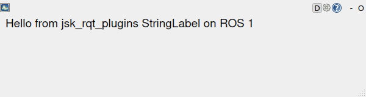 | 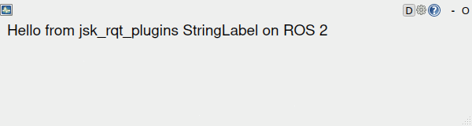 |

How to run (in two terminals):

```bash
# ROS 1
rosrun jsk_rqt_plugins rqt_string_label
rostopic pub -r 10 /sample_string std_msgs/String 'This is a sample string.'
# ROS 2
ros2 run jsk_rqt_plugins rqt_string_label
ros2 topic pub -r 10 /sample_string std_msgs/msg/String "{data: 'This is a sample string.'}"
```

Then click the gear icon (configuration) of the plugin, replace the text with
`/sample_string/data` and push `Done`.

### rqt_status_light

Plugins: StatusLight

Docs: [rqt_status_light](../doc/jsk_rqt_plugins/plugins/rqt_status_light.md)

| ROS 1 | ROS 2 |
|:--:|:--:|
| 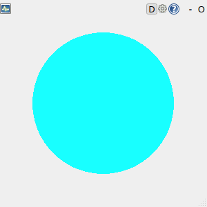 |  |

How to run (in two terminals):

```bash
# ROS 1
rosrun jsk_rqt_plugins rqt_status_light
rostopic pub -r 10 /sample_data std_msgs/UInt8 1
# ROS 2
ros2 run jsk_rqt_plugins rqt_status_light
ros2 topic pub -r 10 /sample_data std_msgs/msg/UInt8 "{data: 1}"
```

Then click the gear icon (configuration) of the plugin, select `/sample_data`
and push `Done`. `1` (success) is cyan, `2` (warn) is yellow and any other value is gray.

### rqt_yn_btn

Plugins: YesNoButton

Docs: [rqt_yn_btn](../doc/jsk_rqt_plugins/plugins/rqt_yn_btn.md)

| ROS 1 | ROS 2 |
|:--:|:--:|
| 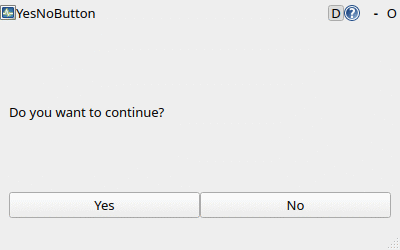 |  |

How to run (in two terminals):

```bash
# ROS 1
rosrun jsk_rqt_plugins rqt_yn_btn
rosservice call /rqt_yn_btn "Select Yes or No"
# ROS 2
ros2 run jsk_rqt_plugins rqt_yn_btn
ros2 service call /rqt_yn_btn jsk_gui_msgs/srv/YesNo "{message: 'Select Yes or No'}"
```

The plugin advertises the `jsk_gui_msgs/YesNo` service `rqt_yn_btn`. The
buttons are enabled while a request waits, and the call returns `yes: True`
or `yes: False` when one of them is pushed.

### sample_image_view2

Plugins: ImageView2Plugin (with image_view2)

Docs: [rqt_image_view2](../doc/jsk_rqt_plugins/plugins/rqt_image_view2.md)

| ROS 1 | ROS 2 |
|:--:|:--:|
|  | 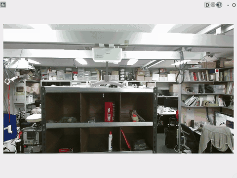 |

How to run:

```bash
# ROS 1
roslaunch jsk_rqt_plugins sample_image_view2.launch
# ROS 2 (in two terminals; the sample of image_view2 in jsk_common)
ros2 launch image_view2 sample_image_view2.launch.xml gui:=false
ros2 run jsk_rqt_plugins rqt_image_view2
```

On ROS 1 the launch file starts image_publisher, image_view2 (without its own
window) and rqt_image_view2. On ROS 2 the image_view2 sample publishes the
image and its markers, and image_view2 draws them (`gui:=false`: without its
own window).

Click the gear icon (configuration) of the plugin, select the image topic
(`/pub_sample_image/image_raw` on ROS 1, `/camera/image` on ROS 2) and push
`Done`. The plugin shows the image drawn by image_view2 (`<image>/marked`),
and dragging on it sends mouse events (`<image>/event`) to image_view2, which
draws the rectangle.

### sample_3dplot

Plugins: Plot3D

Docs: [rqt_3d_plot](../doc/jsk_rqt_plugins/plugins/rqt_3d_plot.md)

| ROS 1 | ROS 2 |
|:--:|:--:|
| 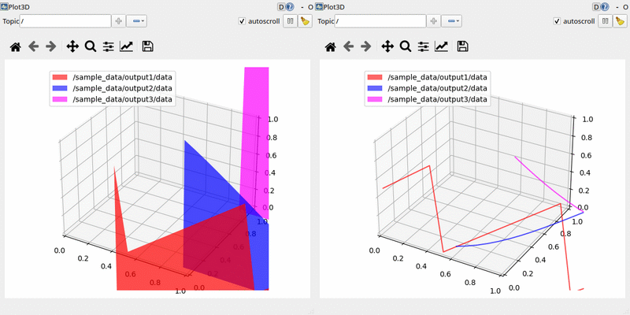 | 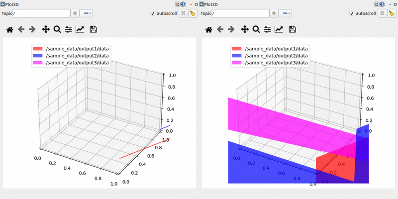 |

How to run:

```bash
# ROS 1
roslaunch jsk_rqt_plugins sample_3dplot.launch
# ROS 2
ros2 launch jsk_rqt_plugins sample_3dplot.launch.py
```

### sample_service_buttons

Plugins: ServiceButtons

Docs: [rqt_service_buttons](../doc/jsk_rqt_plugins/plugins/rqt_service_buttons.md)

| ROS 1 | ROS 2 |
|:--:|:--:|
| 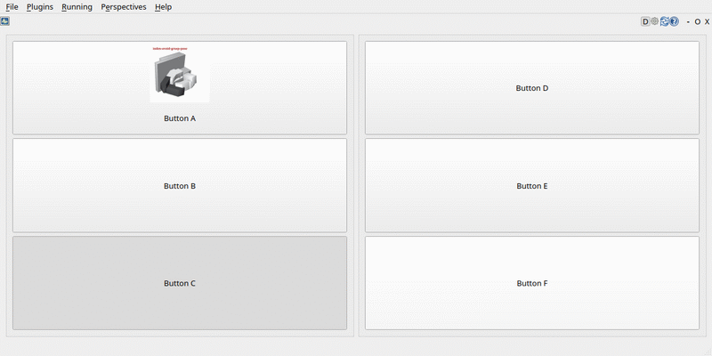 | 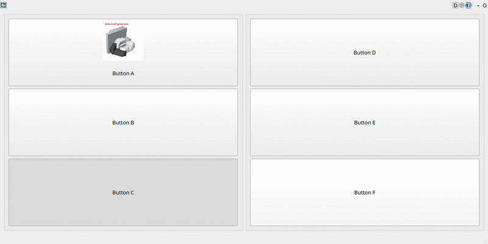 |

How to run:

```bash
# ROS 1
roslaunch jsk_rqt_plugins sample_service_buttons.launch
# ROS 2
ros2 launch jsk_rqt_plugins sample_service_buttons.launch.py
```

The buttons are read from `resource/service_button_layout.yaml`.

### sample_service_radio_buttons

Plugins: ServiceRadioButtons

Docs: [rqt_service_radio_buttons](../doc/jsk_rqt_plugins/plugins/rqt_service_radio_buttons.md)

| ROS 1 | ROS 2 |
|:--:|:--:|
|  | 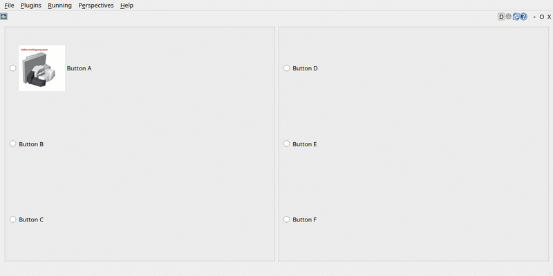 |

How to run:

```bash
# ROS 1
roslaunch jsk_rqt_plugins sample_service_radio_buttons.launch
# ROS 2
ros2 launch jsk_rqt_plugins sample_service_radio_buttons.launch.py
```

The buttons are read from `resource/service_radio_button_layout.yaml`.

### sample_tabbed_buttons

Plugins: ServiceTabbedButtons

Docs: ServiceTabbedButtons has no doc page yet; its tabs are a
[rqt_service_buttons](../doc/jsk_rqt_plugins/plugins/rqt_service_buttons.md) and a
[rqt_service_radio_buttons](../doc/jsk_rqt_plugins/plugins/rqt_service_radio_buttons.md).

| ROS 1 | ROS 2 |
|:--:|:--:|
| 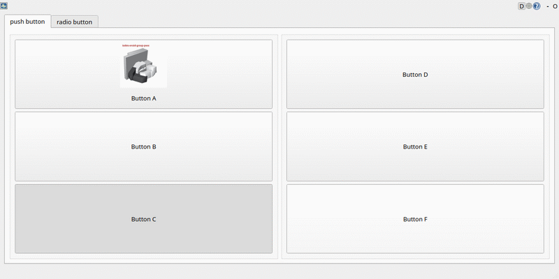 |  |

How to run:

```bash
# ROS 1
roslaunch jsk_rqt_plugins sample_tabbed_buttons.launch
# ROS 2
ros2 launch jsk_rqt_plugins sample_tabbed_buttons.launch.py
```

### sample_drc_mini_maxwell

Plugins: DRCEnvironmentViewer

Docs: [rqt_drc_mini_maxwell](../doc/jsk_rqt_plugins/plugins/rqt_drc_mini_maxwell.md)

| ROS 1 | ROS 2 |
|:--:|:--:|
| 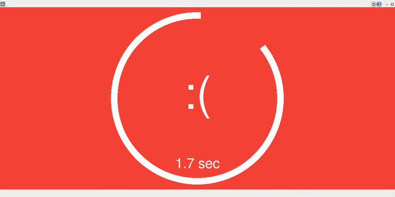 | 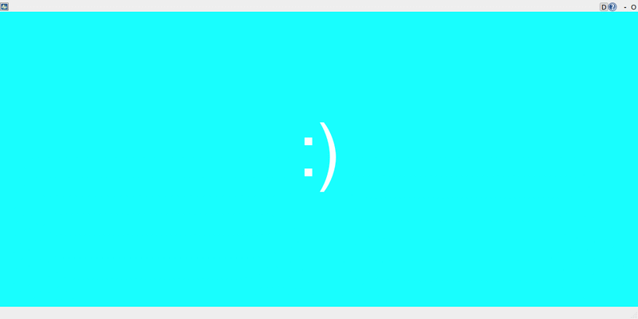 |

How to run:

```bash
# ROS 1
roslaunch jsk_rqt_plugins sample_drc_mini_maxwell.launch
# ROS 2
ros2 launch jsk_rqt_plugins sample_drc_mini_maxwell.launch.py
```

### sample_histogram

Plugins: HistogramPlot

Docs: [rqt_histogram_plot](../doc/jsk_rqt_plugins/plugins/rqt_histogram_plot.md)

| ROS 1 | ROS 2 |
|:--:|:--:|
| 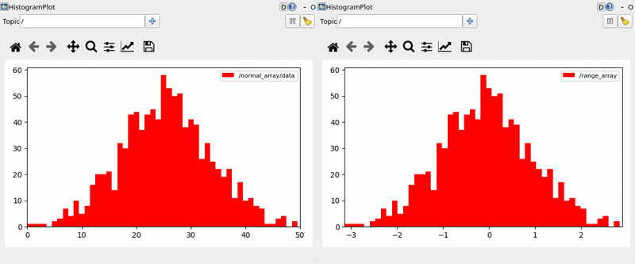 | 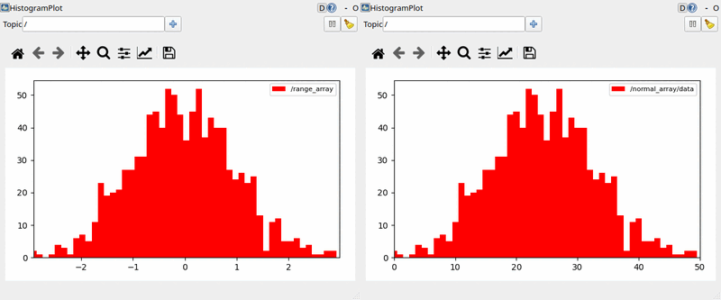 |

How to run:

```bash
# ROS 1
roslaunch jsk_rqt_plugins sample_histogram.launch
# ROS 2 (needs jsk_recognition_msgs)
ros2 launch jsk_rqt_plugins sample_histogram.launch.py
```

### sample_2dplot

Plugins: Plot2D

Docs: [rqt_2d_plot](../doc/jsk_rqt_plugins/plugins/rqt_2d_plot.md)

| ROS 1 | ROS 2 |
|:--:|:--:|
| 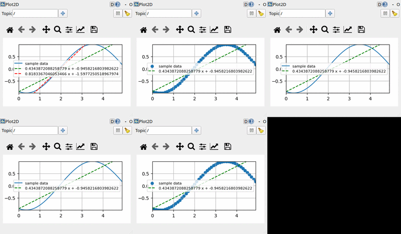 | 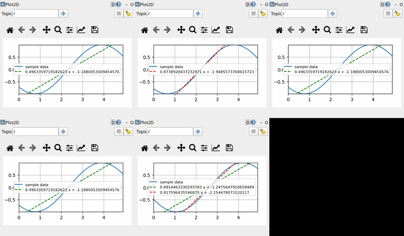 |

How to run:

```bash
# ROS 1
roslaunch jsk_rqt_plugins sample_2dplot.launch
# ROS 2 (needs jsk_recognition_msgs)
ros2 launch jsk_rqt_plugins sample_2dplot.launch.py
```
