jsk_rviz_plugins
================

Displays, panels and tools for rviz (ROS 1) and rviz2 (ROS 2): overlay text
and charts, pictograms, gauges, recognition results and more.
The same source tree builds for ROS 1 and ROS 2. The samples below have a
`<sample>.launch` for ROS 1 and a `<sample>.launch.py` for ROS 2.

On ROS 2, the displays of jsk_recognition_msgs (BoundingBoxArray,
PolygonArray, SegmentArray) and their samples are built only when
jsk_recognition_msgs is found. PolygonArray also needs jsk_recognition_utils.
jsk_recognition_msgs is not released for ROS 2 yet, so build it from source in
your workspace.

The properties of each plugin are documented in [`doc/jsk_rviz_plugins`](../doc/jsk_rviz_plugins)
(also on [read the docs](https://jsk-visualization.readthedocs.io/en/latest/jsk_rviz_plugins/index.html)).

Samples
-------

- [overlay_sample](#overlay_sample): OverlayText, String, Plotter2D, PieChart, OverlayImage, OverlayMenu, OverlayDiagnostic
- [pictogram_sample](#pictogram_sample): Pictogram, PictogramArray
- [linear_gauge_sample](#linear_gauge_sample): LinearGauge
- [piechart_sample](#piechart_sample): PieChart
- [robot_command_interface_sample](#robot_command_interface_sample): RobotCommandInterfaceAction (panel)
- [service_call_panel](#service_call_panel): EmptyServiceCallInterfaceAction (panel)
- [boundingbox_sample](#boundingbox_sample): BoundingBoxArray
- [polygon_array_sample](#polygon_array_sample): PolygonArray
- [segment_array_sample](#segment_array_sample): SegmentArray

Each sample starts rviz / rviz2 with a config of its own. The data-display
samples also start nodes that publish the sample data; their ROS 2 launch
files take `gui:=false` to start without rviz2. The panel samples
(`robot_command_interface_sample` and `service_call_panel`) always start
rviz2 and do not provide sample publishers.

### overlay_sample

Plugins: OverlayText, String, Plotter2D, PieChart, OverlayImage, OverlayMenu, OverlayDiagnostic

Docs: [OverlayText](../doc/jsk_rviz_plugins/plugins/overlay_text.md),
[String](../doc/jsk_rviz_plugins/plugins/string.md),
[Plotter2D](../doc/jsk_rviz_plugins/plugins/plotter_2d.md),
[PieChart](../doc/jsk_rviz_plugins/plugins/pie_chart.md)
(OverlayImage, OverlayMenu and OverlayDiagnostic have no doc page yet)

| ROS 1 | ROS 2 |
|:--:|:--:|
| 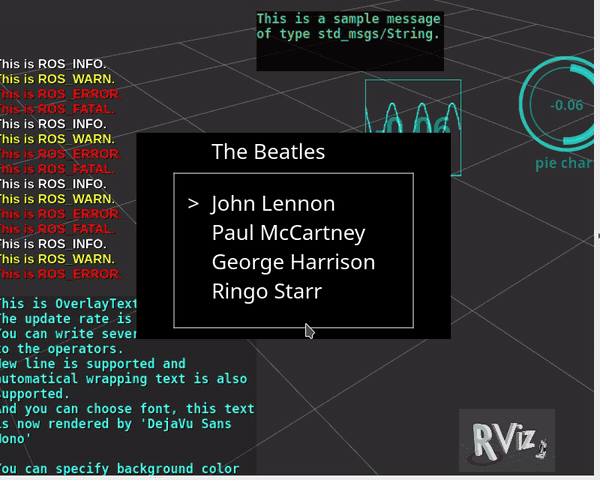 | 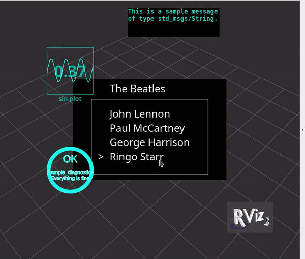 |

How to run:

```bash
# ROS 1
roslaunch jsk_rviz_plugins overlay_sample.launch
# ROS 2
ros2 launch jsk_rviz_plugins overlay_sample.launch.py
```

On ROS 2 the sample has no rosconsole overlay (`rosconsole_overlay_text.py` is ROS 1 only).

### pictogram_sample

Plugins: Pictogram, PictogramArray

Docs: [Pictogram](../doc/jsk_rviz_plugins/plugins/pictogram.md)

| ROS 1 | ROS 2 |
|:--:|:--:|
| 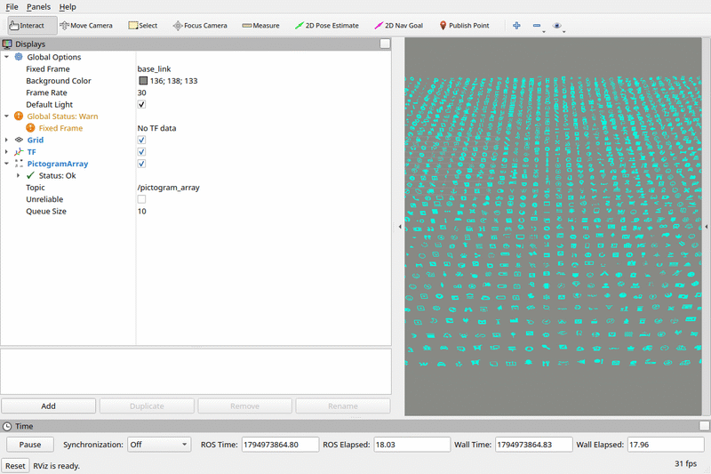 | 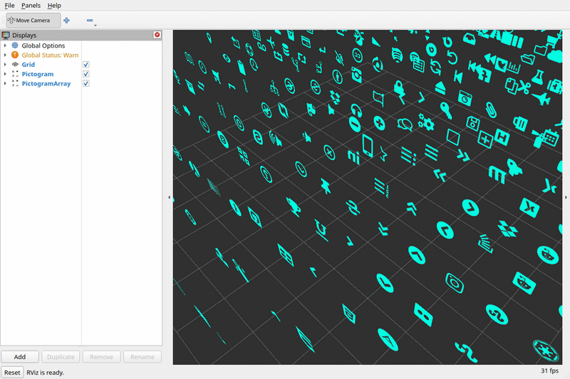 |

How to run:

```bash
# ROS 1
roslaunch jsk_rviz_plugins pictogram_sample.launch
# ROS 2
ros2 launch jsk_rviz_plugins pictogram_sample.launch.py
```

### linear_gauge_sample

Plugins: LinearGauge

Docs: [LinearGauge](../doc/jsk_rviz_plugins/plugins/linear_gauge.md)

| ROS 1 | ROS 2 |
|:--:|:--:|
| 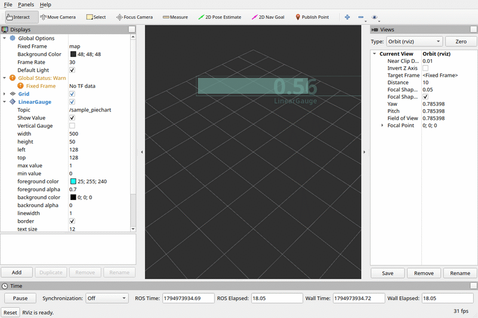 | 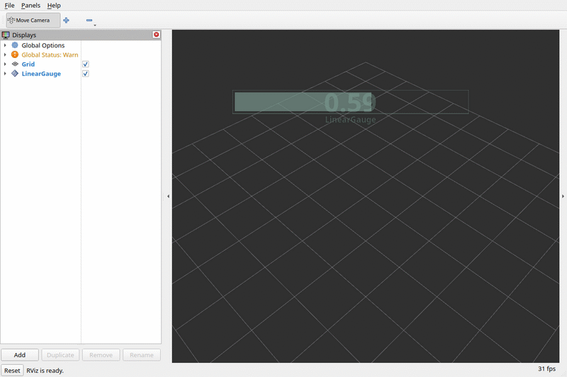 |

How to run:

```bash
# ROS 1
roslaunch jsk_rviz_plugins linear_gauge_sample.launch
# ROS 2
ros2 launch jsk_rviz_plugins linear_gauge_sample.launch.py
```

### piechart_sample

Plugins: PieChart

Docs: [PieChart](../doc/jsk_rviz_plugins/plugins/pie_chart.md)

| ROS 1 | ROS 2 |
|:--:|:--:|
| 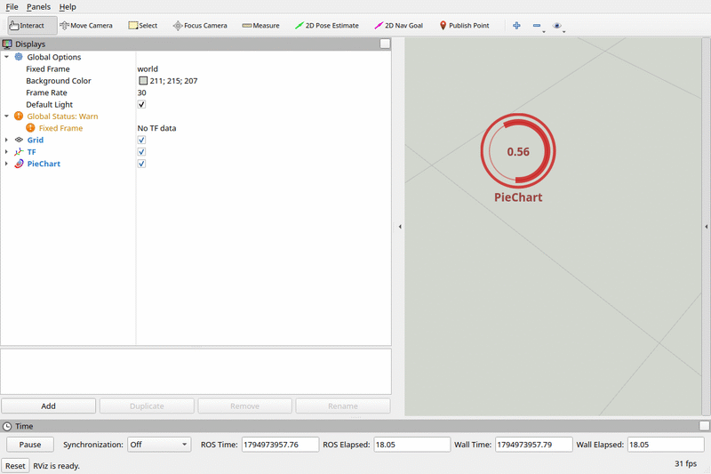 | 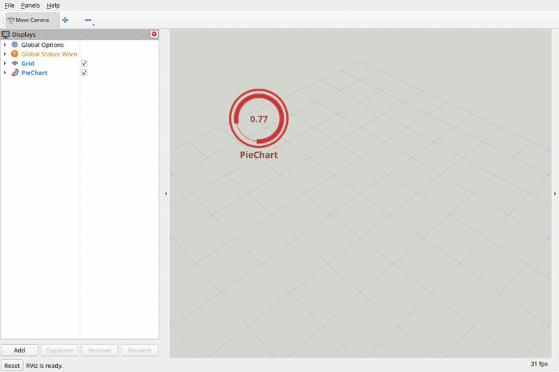 |

How to run:

```bash
# ROS 1
roslaunch jsk_rviz_plugins piechart_sample.launch
# ROS 2
ros2 launch jsk_rviz_plugins piechart_sample.launch.py
```

### robot_command_interface_sample

Plugins: RobotCommandInterfaceAction (panel)

Docs: [RobotCommandInterfaceAction](../doc/jsk_rviz_plugins/panels/robot_command_interface_action.md)

| ROS 1 | ROS 2 |
|:--:|:--:|
| 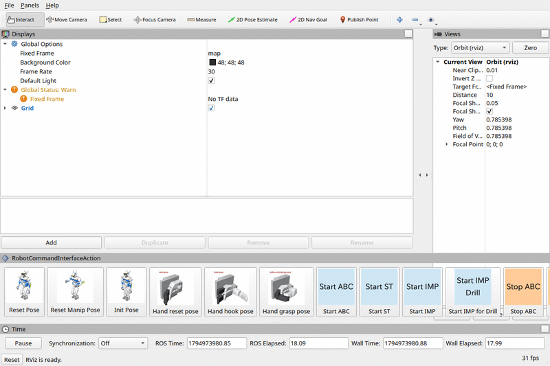 | 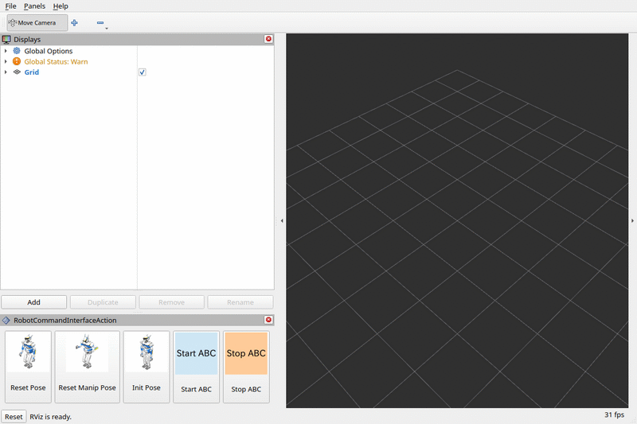 |

How to run:

```bash
# ROS 1
roslaunch jsk_rviz_plugins robot_command_interface_sample.launch
# ROS 2
ros2 launch jsk_rviz_plugins robot_command_interface_sample.launch.py
```

The buttons are read from `config/default_robot_command.yaml` (ROS 1) /
`config/ros2/default_robot_command.yaml` (ROS 2).

### service_call_panel

Plugins: EmptyServiceCallInterfaceAction (panel)

Docs: EmptyServiceCallInterfaceAction has no doc page yet.

| ROS 1 | ROS 2 |
|:--:|:--:|
| 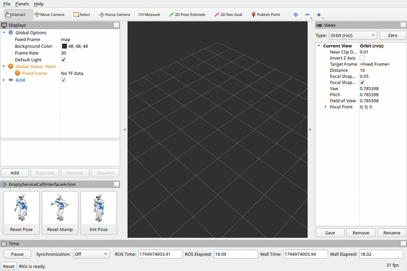 | 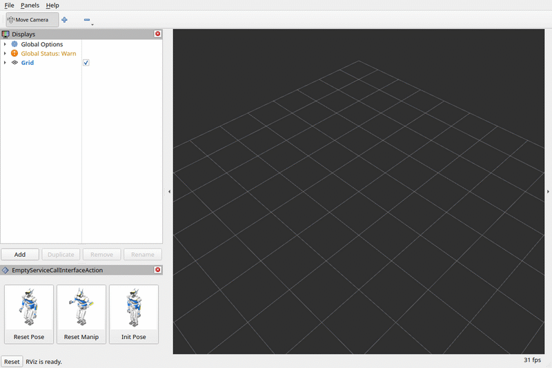 |

How to run:

```bash
# ROS 1
roslaunch jsk_rviz_plugins service_call_panel.launch
# ROS 2
ros2 launch jsk_rviz_plugins service_call_panel.launch.py
```

The buttons are read from `config/command_samples.yaml` (ROS 1) /
`config/ros2/command_samples.yaml` (ROS 2); each button calls a
`std_srvs/Empty` service.

### boundingbox_sample

Plugins: BoundingBoxArray

Docs: [BoundingBoxArray](../doc/jsk_rviz_plugins/plugins/bounding_box_array.rst)

| ROS 1 | ROS 2 |
|:--:|:--:|
| 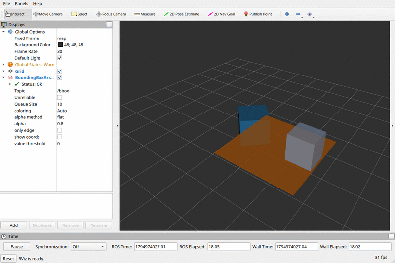 | 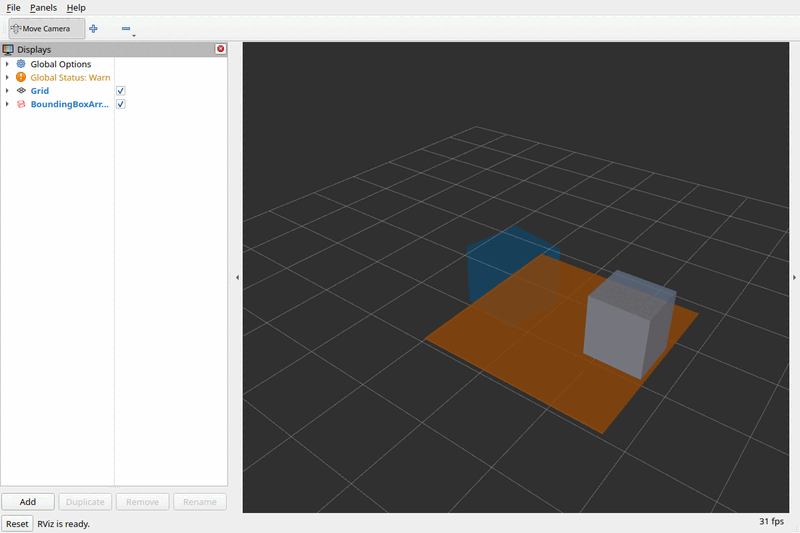 |

How to run:

```bash
# ROS 1
roslaunch jsk_rviz_plugins boundingbox_sample.launch
# ROS 2 (needs jsk_recognition_msgs)
ros2 launch jsk_rviz_plugins boundingbox_sample.launch.py
```

### polygon_array_sample

Plugins: PolygonArray

Docs: [PolygonArray](../doc/jsk_rviz_plugins/plugins/polygon_array.md)

| ROS 1 | ROS 2 |
|:--:|:--:|
| 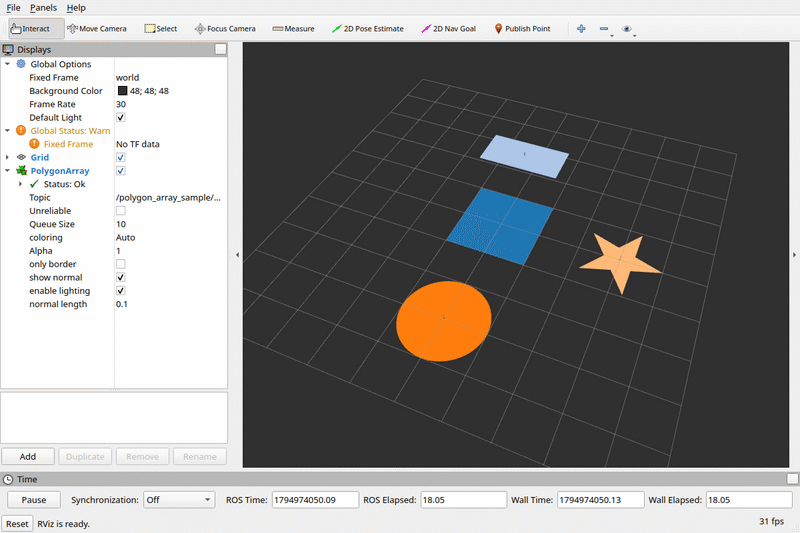 | 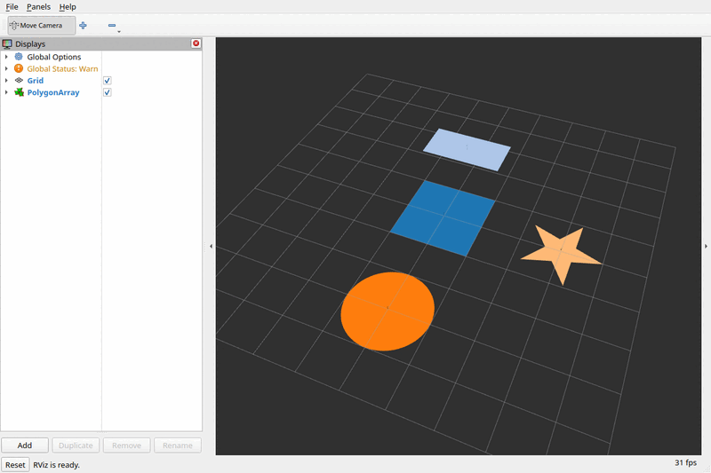 |

How to run:

```bash
# ROS 1
roslaunch jsk_rviz_plugins polygon_array_sample.launch
# ROS 2 (needs jsk_recognition_msgs and jsk_recognition_utils)
ros2 launch jsk_rviz_plugins polygon_array_sample.launch.py
```

### segment_array_sample

Plugins: SegmentArray

Docs: [SegmentArray](../doc/jsk_rviz_plugins/plugins/SegmentArray.rst)

| ROS 1 | ROS 2 |
|:--:|:--:|
| 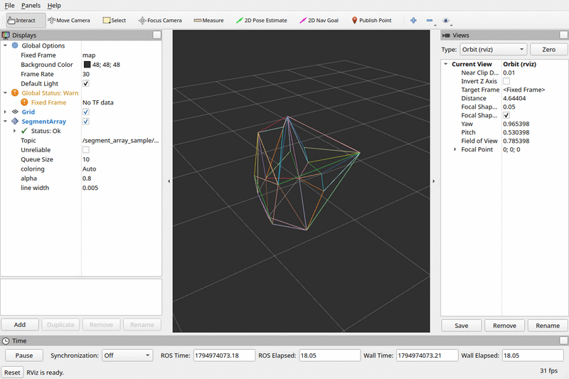 | 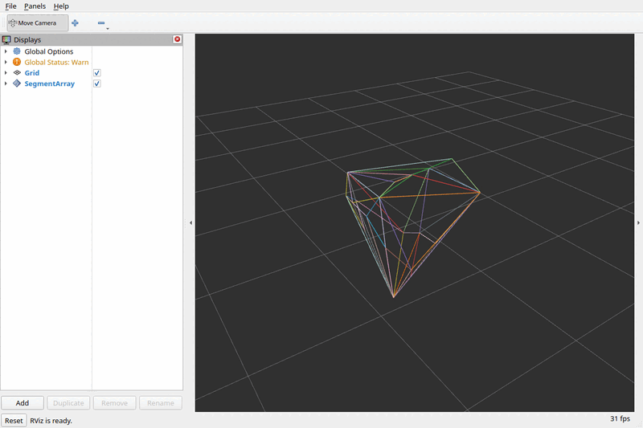 |

How to run:

```bash
# ROS 1
roslaunch jsk_rviz_plugins segment_array_sample.launch
# ROS 2 (needs jsk_recognition_msgs)
ros2 launch jsk_rviz_plugins segment_array_sample.launch.py
```
